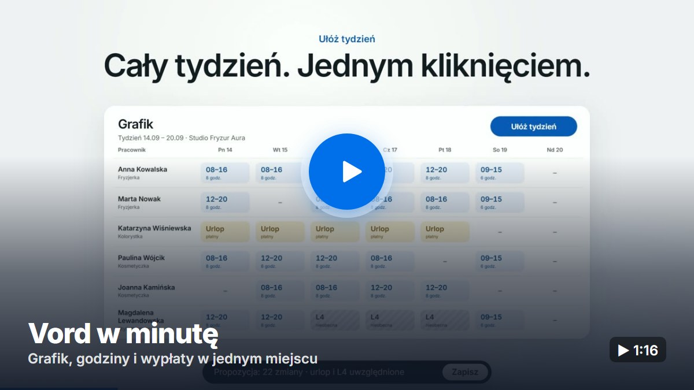
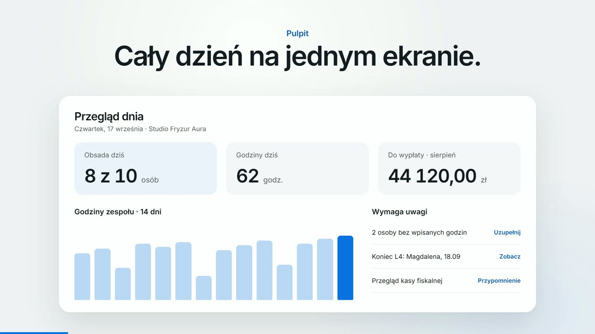
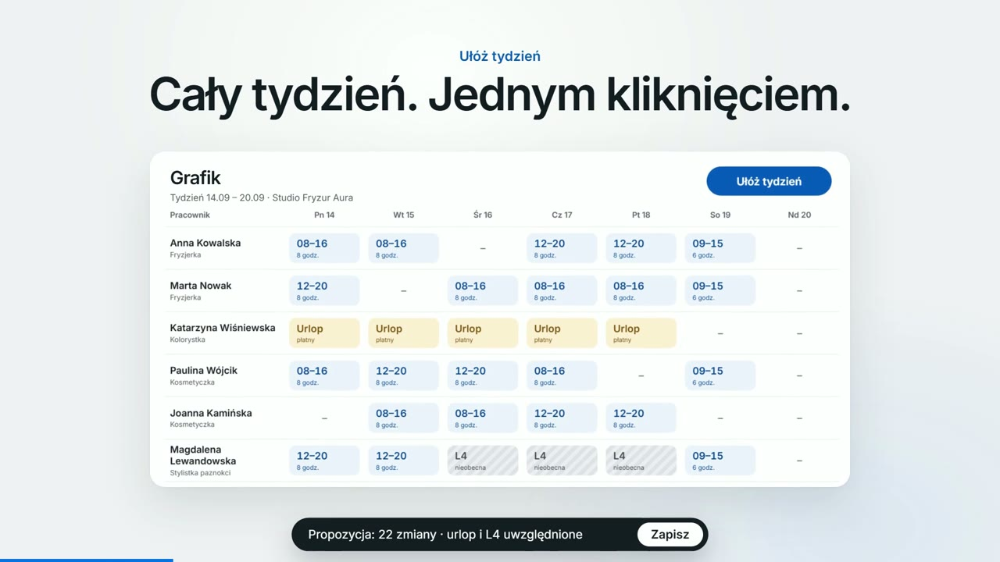
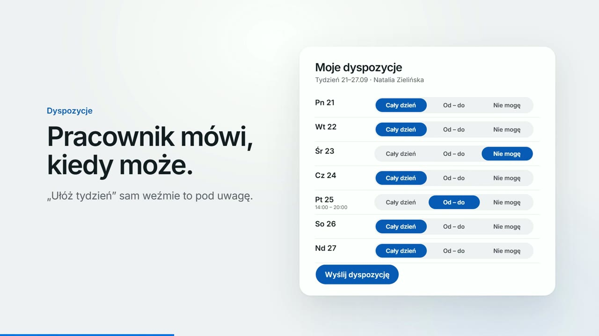
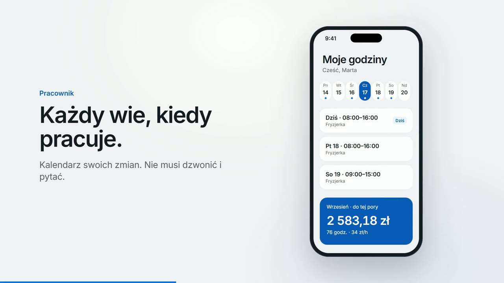
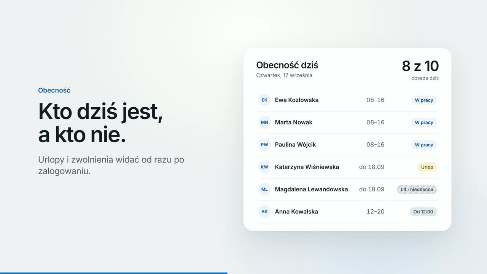
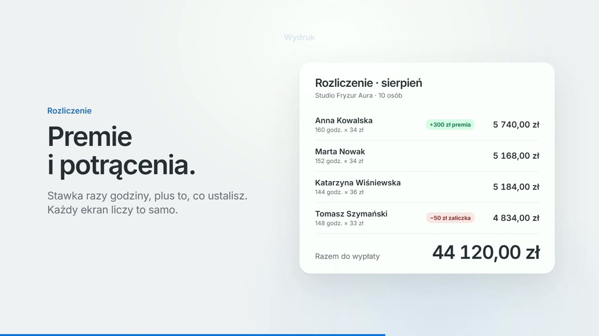
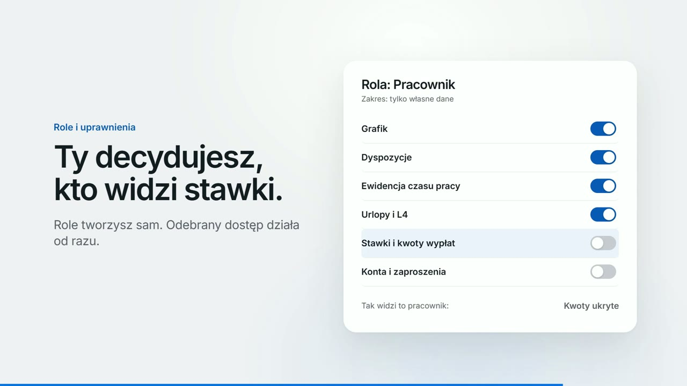

# Vord

**English** · [Polski](README.pl.md)

Scheduling, time tracking and payroll for small businesses with 1 to 20 people, such as hair salons, workshops and clinics. Plan the week, log the hours and calculate pay in one place, without a notebook or phone calls.

**[vord.pl](https://vord.pl)** · In daily use at a real company · The source code is private, and this repository is a showcase.

## The problem

Small teams often plan shifts in a notebook, a spreadsheet or a group chat. Someone always has the old version, employees call to ask when they work, and at the end of the month the owner sits down with a calculator to count hours and pay.

## What Vord does

| | |
|---|---|
|  **Dashboard.** Who is in today, hours worked, payroll so far and what needs attention. |  **Plan the week in one click.** A full schedule built from availability, leave and sick days. Swaps are drag and drop. |
|  **Availability.** Employees say when they can work, and the planner takes it into account. |  **Employee view.** Everyone sees their own shifts and earnings on their phone. |
|  **QR code in the back room.** Print it once; scanning it always shows the current schedule. |  **Attendance.** Leave and sick days are visible right after logging in. |
|  **Payroll with bonuses and deductions.** Rate times hours, plus whatever was agreed. Every screen adds up the same. |  **Roles and permissions.** You decide who sees pay rates, and revoked access works immediately. |

Also included: time tracking (planned vs. actual hours), announcements with read confirmations, reminders, printable A4 schedules and payslips, and statistics.

## Data and security

- Each company has its own separate database
- Nightly backups, copied off the server
- Passwords are stored only as secure hashes

## Status

Live at [vord.pl](https://vord.pl) and used every day by a company to plan shifts and pay its team. The app is in Polish.

Contact: [kontakt@vord.pl](mailto:kontakt@vord.pl)
