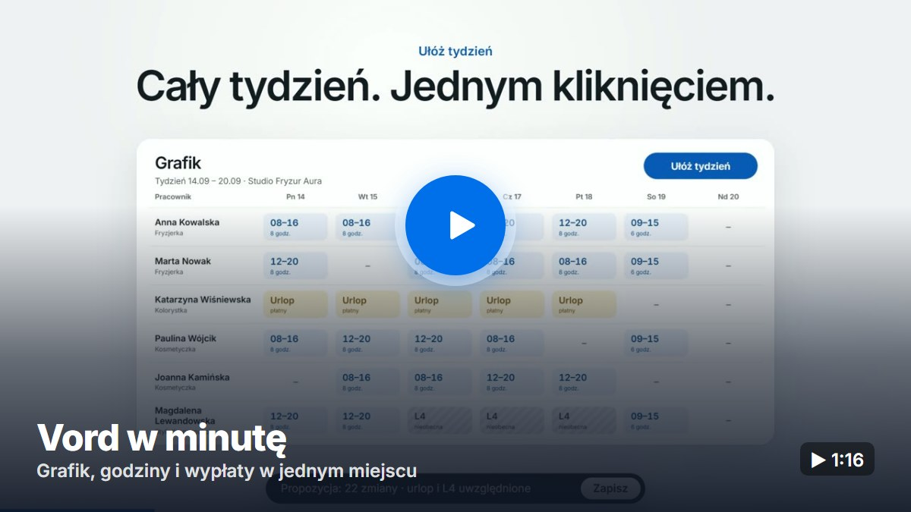
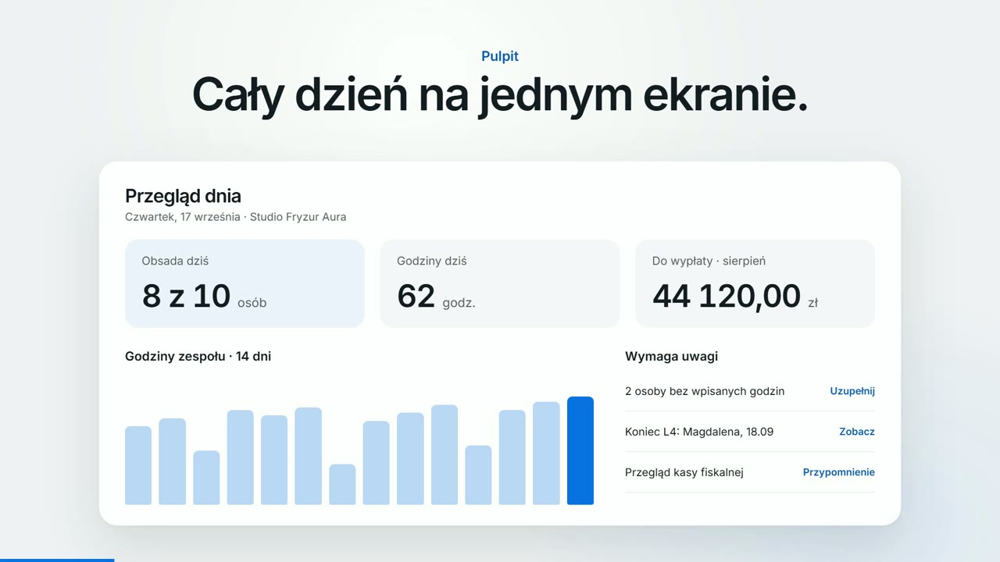
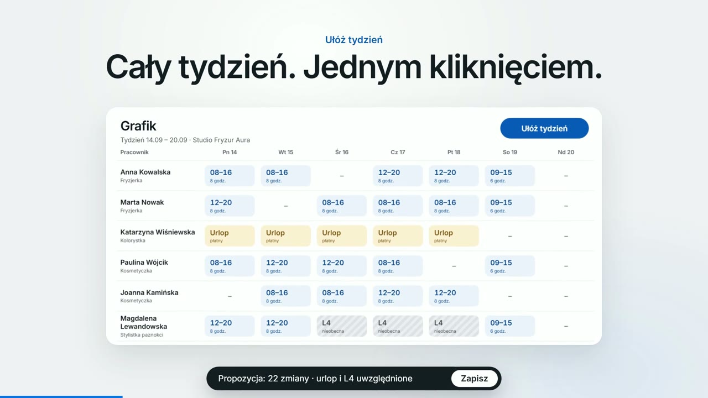
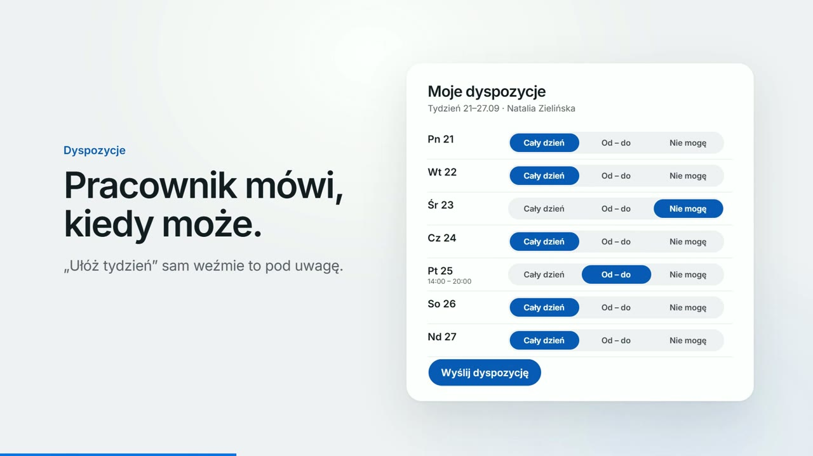
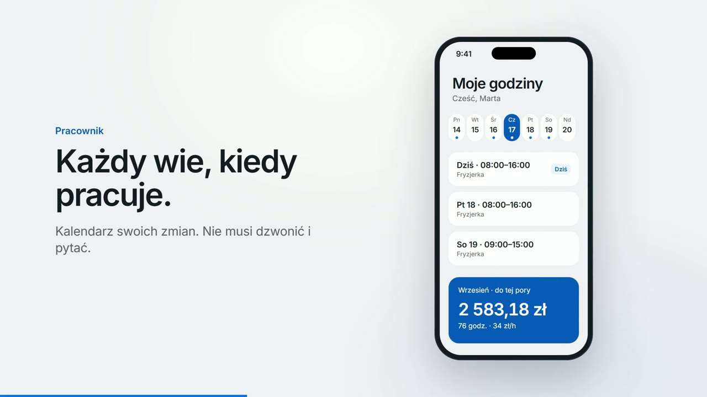
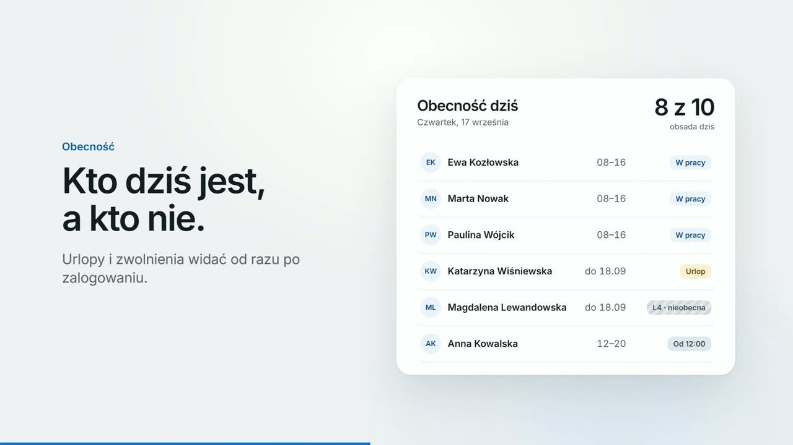
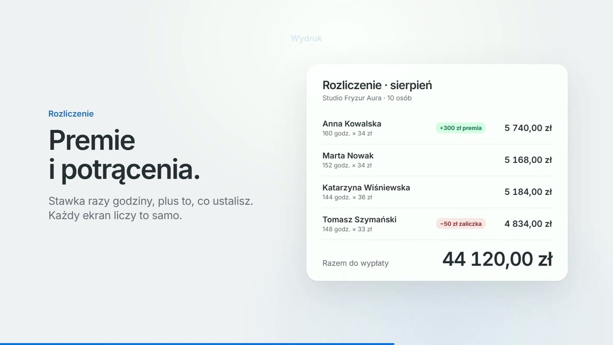
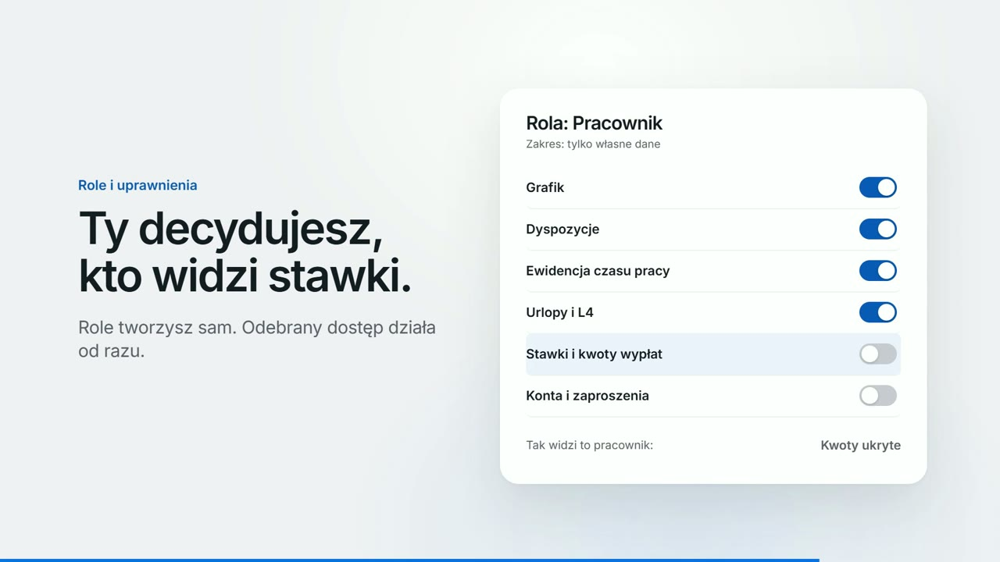

# Vord

[English](README.md) · **Polski**

Grafik, ewidencja czasu pracy i wypłaty dla małych firm od 1 do 20 osób: salonów, warsztatów, gabinetów. Zaplanuj tydzień, zapisz przepracowane godziny i policz wypłaty w jednym miejscu, bez zeszytu i bez dzwonienia.

**[vord.pl](https://vord.pl)** · Na co dzień używany w prawdziwej firmie · Kod źródłowy jest prywatny, to repozytorium jest wizytówką.

## Problem

Małe zespoły często planują zmiany w zeszycie, w Excelu albo na grupowym czacie. Ktoś zawsze ma starą wersję, pracownicy dzwonią z pytaniem, kiedy pracują, a pod koniec miesiąca właściciel siada z kalkulatorem i liczy godziny i wypłaty.

## Co robi Vord

| | |
|---|---|
|  **Pulpit.** Kto dziś jest, ile godzin przepracowano, ile do wypłaty i co wymaga uwagi. |  **Cały tydzień jednym kliknięciem.** Gotowy grafik z dyspozycji, urlopów i L4. Zamiany przeciąganiem. |
|  **Dyspozycje.** Pracownik mówi, kiedy może, a układanie grafiku bierze to pod uwagę. |  **Widok pracownika.** Każdy widzi w telefonie swoje zmiany i ile zarobił. |
|  **Kod QR na zapleczu.** Kartka wisi raz, a po zeskanowaniu zawsze widać aktualny grafik. |  **Obecność.** Urlopy i zwolnienia widać od razu po zalogowaniu. |
|  **Wypłaty z premiami i potrąceniami.** Stawka razy godziny, plus to, co ustalisz. Każdy ekran liczy to samo. |  **Role i uprawnienia.** Ty decydujesz, kto widzi stawki. Odebrany dostęp działa od razu. |

Do tego: ewidencja czasu pracy (plan i faktyczne godziny), ogłoszenia z potwierdzeniem przeczytania, przypomnienia, wydruki grafiku i wypłat na A4 oraz statystyki.

## Dane i bezpieczeństwo

- Każda firma ma osobną bazę danych
- Kopia zapasowa co noc, przechowywana poza serwerem
- Hasła są zapisywane wyłącznie jako bezpieczne skróty

## Status

Działa na [vord.pl](https://vord.pl) i jest na co dzień używany w firmie do układania grafiku i rozliczania zespołu.

Kontakt: [kontakt@vord.pl](mailto:kontakt@vord.pl)
